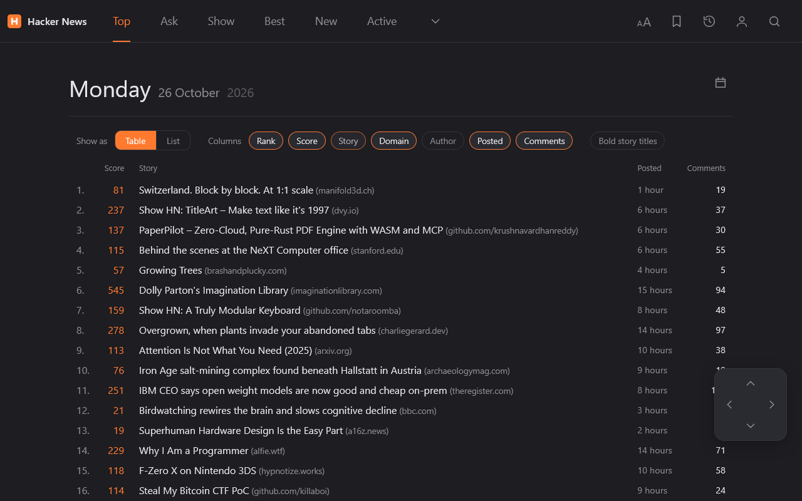

# HN Redesign

A Firefox extension that restyles [news.ycombinator.com](https://news.ycombinator.com): tabs and toolbar, five themes, table or list view, bookmarks, new-reply badges, selection tools, user cards and keyboard shortcuts. Free, no account, nothing leaves your browser.



## Features

- Five themes (light, classic, slate, dark, black), Sans / Serif / Inter type, adjustable text size, line spacing and page width.
- Table or list front page with selectable columns, short ages, a date picker for earlier days.
- Bookmarks for stories, comments, highlights and users, with JSON backup and restore.
- "N new" badges on stories and marked new comments with arrows to step through them.
- Selection popup (highlight, quote reply, copy, read aloud, search), user hover cards, a control pad and shortcuts.
- Turn it off in one click and HN looks exactly as before.

Not affiliated with Y Combinator. Independent implementation; no third-party extension code or assets.

## Privacy

Everything is stored in `storage.local` on your machine. The only network call is a read-only lookup of public user and item data from `hacker-news.firebaseio.com`. No tracking, no analytics, no remote code. Details: [docs/listing.md](docs/listing.md).

## Install

- From source: open `about:debugging#/runtime/this-firefox`, choose **Load Temporary Add-on**, pick `src/manifest.json`.
- Packaged: `mise run build` writes `web-ext-artifacts/hn_redesign-<version>.zip`.

Requires Firefox 142 or newer.

## Develop

No build step: `src/` is the extension. Tooling is managed with [mise](https://mise.jdx.dev).

```powershell
mise run setup:browsers   # once: Chromium for Playwright
mise run dev:ci           # web-ext lint + Playwright tests (the merge gate)
mise run smoke:firefox    # headless real Firefox against live HN (needs network)
mise run screenshots      # regenerate docs/screenshots/
mise run build            # package the extension
mise run dev:run          # open Firefox with the extension loaded
```

Tests serve HN-shaped fixtures with the network mocked. See [docs/architecture.md](docs/architecture.md) and [docs/spec.md](docs/spec.md). Contributions are welcome: read [CONTRIBUTING.md](CONTRIBUTING.md) first.

## Release gate

A build is only published to addons.mozilla.org after the maintainer has loaded it in their own Firefox and checked it by hand.

## Licence

[MIT](LICENSE). The bundled Inter font keeps its own SIL Open Font License 1.1 ([src/fonts/OFL.txt](src/fonts/OFL.txt)).
