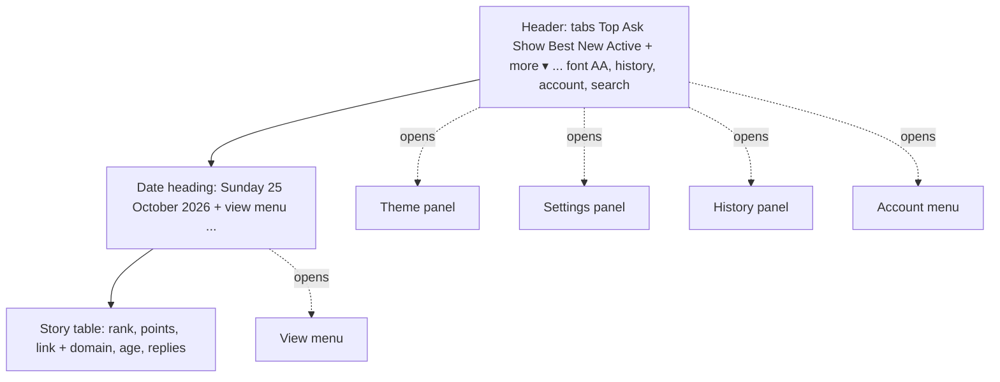

# Spec: Hacker News Refresh (clean-room)

Independent implementation: own code, name, icon and wording; no third-party extension code or assets were used.
Firefox MV2, target host `news.ycombinator.com`.

## Functional (v1 = free tier equivalents)
- F1 Themes: light, classic HN, slate, dark, black.
- F2 Fonts: sans / serif, adjustable size.
- F3 Styles: column width, line height, justified text.
- F4 History: quick list of previously viewed stories (local).
- F5 Comments: inline reply, prev/next in comment menu.
- F6 Index: list / table view, selectable columns.
- F7 Visited links fade, toggle.
- F8 Icons on hover, toggle.
- F9 Profiles: tabbed layout, clickable links.
- F10 Account features reachable from a menu.
- F11 One-click switch to original HN design.
- F12 Applies automatically, no setup.

## Later
Superseded by v2 below, which brings these into scope.

## Non-functional
- NF1 Permissions: `storage`, host `news.ycombinator.com`, `hacker-news.firebaseio.com` (for user/item data). No tracking, no remote code.
- NF2 No flash of unstyled content: CSS injected at `document_start`.
- NF3 Resilient to HN markup changes: select by stable structure, one selector map, fail to original design.
- NF4 Desktop-first; mobile layout out of scope for v1.
- NF5 Settings in `storage.local`; exportable.

## Tasks
1. [x] Selector map + base layout CSS (F12, NF2, NF3)
2. [x] Themes + fonts + styles via CSS variables (F1-F3)
3. [x] Settings page / popup, storage (F7, F8, F11, NF5)
4. [x] Index list/table view (F6)
5. [x] Comments: inline reply (F5); prev/next already ships in HN, kept visible
6. [x] History (F4), profiles (F9), account menu (F10)
7. [x] Playwright tests against HN-shaped fixtures + mise dev:ci
8. [~] AMO listing text, icon, build zip done; submission (needs AMO login) pending

# v2: in-page UI

Common redesign patterns (flat page, tabs, toolbar, panels). Own code, icons, wording and name; no paid tier, payment or licence code. Every feature ships free.

## Layout (list page)

## Functional
Shell
- G1 Flat full-width page (no card), content column left-aligned, header with bottom border.
- G2 Top tabs: Top, Ask, Show, Best, New, Active; active tab underlined in accent; more menu (past, comments, jobs, submit).
- G3 Date heading on the front page: weekday large, date muted, year dimmer; follows `?day=` when present.
- G4 Header toolbar, right side: font (AA), history (clock), account (person), search icons. Own SVG icons.
- G5 Ages shortened: "3 hours", "43 mins", "1 day".
- G6 Fixed header (sticky) toggle.

Panels (dropdowns anchored to the toolbar; close on outside click or Esc)
- G7 Panel has tabs: Theme | Settings | About.
- G8 Theme tab: Sans / Serif cards; sliders for font size, line height, column width; five swatches (light, classic, slate, dark, black).
- G9 Settings tab toggles: Fixed header, Open links in new tab, Auto dark theme (follows OS), Font smoothing, Fade visited links, Show icons on hover.
- G10 About tab: version, link to source/support, no upsell.
- G11 View menu (...): View: List / Table (checkmark), Columns submenu, Bold title.
- G12 Account menu: username, "N karma", Stories, Comments, Favorites, Upvoted, Hidden, Logout. Logged out: login link.
- G13 History panel: recently viewed stories (clear button).
- G14 Search icon: opens HN search (hn.algolia.com) in the same tab rules as G9; no data sent by the extension.
- G15 The toolbar popup shrinks to a launcher; all settings live in the panels.

Local data (storage.local, no account)
- G16 Bookmarks: stories, comments, highlights, users; bookmark icon on each; bookmarks page/panel; JSON backup and restore.
- G17 New-replies badge: orange "N new" beside a story's replies count, from comment counts stored at last visit; in a thread, new comments marked and orange arrows step through them.
- G18 Highlighter: select text, bookmark icon saves a highlight with link to its comment.
- G19 Selection popup on selected text: highlight, quoted reply, copy, text-to-speech (speechSynthesis), HN search.
- G20 User popup on username hover: account age, karma, scrollable about, bookmark user (fetch from hacker-news.firebaseio.com; adds that host permission).
- G21 Control pad + keyboard shortcuts: move between comments and pages.
- G22 Date picker: jump to the front page of an earlier day (`front?day=`).

## Non-functional (additions)
- NF6 Every new fetch host is named in the listing's permission notes; G20 is the only one planned.
- NF7 Panels keyboard-accessible: focus trap, Esc closes, toggles are real checkboxes/switches with labels, icon buttons have accessible names.
- NF8 All new UI built from DOM APIs (no innerHTML); styles scoped under `data-hn-on`; off still restores HN exactly.
- NF9 Each phase ends with Playwright tests, `mise run dev:ci` green and a real-Firefox smoke check.

## Tasks v2 (phased)
- P0 [x] Fix `dev:run` quoting; real-Firefox smoke task; reply link font size
- P1 [x] Shell: flat layout, tabs + more menu, date heading, ages, header toolbar with history, account and search (G1-G6, G12-G14); settings plumbing for G6/G9 toggles
- P2 [x] Panels: AA button with Theme, Settings, About tabs, View menu, popup becomes launcher (G7-G11, G15)
- P4 [x] Bookmarks + backup (G16)
- P5 [x] New replies + arrows (G17); highlighter + selection popup (G18, G19)
- P6 [x] User popup, control pad + shortcuts, date picker (G20-G22)
- P7 [~] Screenshots and listing done; AMO submission is gated on the maintainer's local test (README, Release gate)
- NF10 Data that grows (history, seen comments, bookmarks) is stored one key per item so tabs writing at once cannot overwrite each other; only trimming reads the whole set. Non-settings writes must not re-render the page.

# v3: frame, type, table

Measured at 1650px. Our extras (calendar, bookmark icon, control pad) stay.

## Requirements
- V1 Content column is centred, 1060px wide by default (`--width`), side margins equal within 2px.
- V2 Header is 68px: brand (own mark + "Hacker News", links to /news) at the far left, tabs starting on the column's left edge (never closer than 180px to the left edge, so they clear the brand), toolbar at the far right.
- V3 Tabs 1.2x the base size with 48px gaps. Under 1000px wide: icon-only brand, 20px gaps, nothing scrolls sideways.
- V4 Heading about 2.4x the base size with a 1px rule under it; the table's column headings have no rule of their own.
- V5 Table rows 32px apart; rank shown as "1." and left-aligned; Replies in full text colour, Age and By muted.
- V6 "More" is a centred pill button (panel colour, 8px radius, 8x22px padding); the YC banner is muted.

- V7 Font choices: Sans, Serif and bundled Inter (OFL, Latin + Latin Extended, loaded only when chosen). The bookmark button sits at the title cell's right edge so it can never add a line to a row.

## Tasks v3
- A [x] Frame: centred column, three-zone header, brand mark, tab size and gaps, narrow-window rules (V1-V3)
- B [x] Table: rank dot, reply colour, 32px rows, More pill, heading rule (V4-V6)
- D [x] Geometry tests at 1650px and 900px, real-Firefox screenshot compare, store screenshots regenerated
- E [x] Inter font option (bundled), bookmark button pinned to the cell edge
- C [ ] Not done (option 2 only): pad off on lists, calendar into the `...` menu

## Own wording (v3 follow-up)
- W1 Every user-facing label is our own: settings (Keep the header in view, Open stories in a new tab, Follow system dark mode, Smooth text edges, Dim stories you have opened, Hide vote arrows until hover, Show the navigation pad), tabs (Appearance, Options, About), sliders (Text size, Line spacing, Page width), view menu (Show stories as, Show columns, Bold story titles), table headings (Score, Story, By, Posted, Comments), account menu (Submissions, Log out).
- W2 The store listing text is written in its own order and words (`docs/listing.md`).
- Layout stays as chosen (tabs, date heading): common patterns, not copied code or assets.
- W3 Options are laid out our own way: a settings drawer on the right (one scrolling page: Colour tiles drawn in each theme's own colours, a segmented typeface control, text size / line spacing / page width with -/+ steppers, switches with one-line descriptions, About), an always-visible view bar under the heading (Show as Table | List, column chips, Bold story titles) instead of a `...` menu, and a profile card (initial, karma, links in two columns) for the account.
